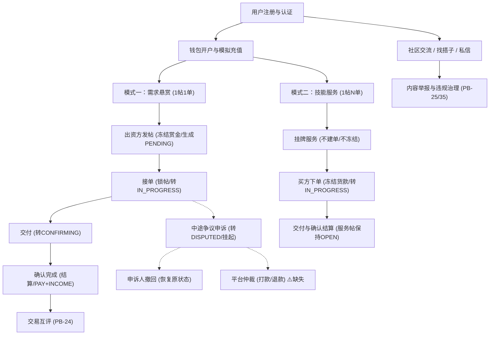
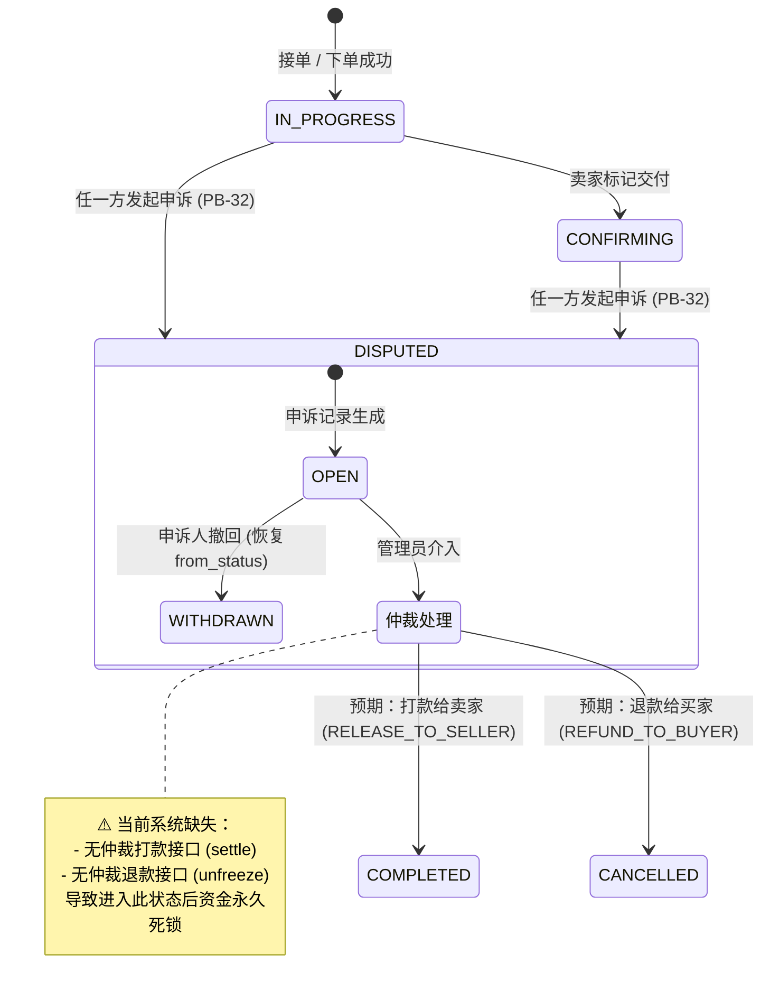
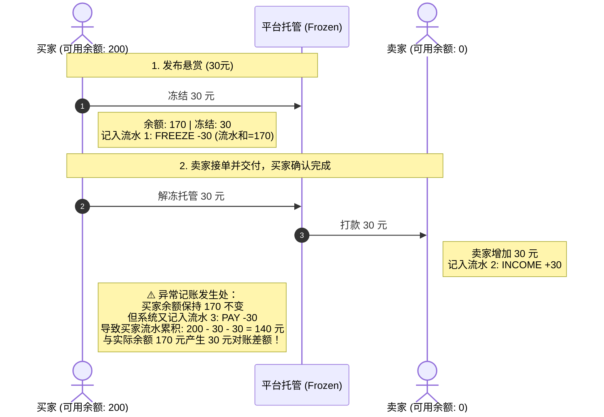

# 校园悬赏平台 · 全业务流程测试报告与问题清单

> **测试基准**：[校园悬赏平台-产品需求文档-PRD.md](../docs/校园悬赏平台-产品需求文档-PRD.md)、[Product 与 Sprint Backlog](../校园悬赏平台-Product与Sprint-Backlog.md)、[用户端后端接口文档](../docs/用户端后端接口文档.md)
> **测试环境**：Windows 11 / Java 21 / Spring Boot 3.4 (4.1.2) / Node.js 24 / MySQL 8.0 / 双端在线运行 (`127.0.0.1:8080` & `127.0.0.1:5173`)
> **测试日期**：2026-11-17

---

## 一、测试概述与执行矩阵

本次测试覆盖了学生端与管理端的全业务动线，通过自动化脚本、端到端接口链调用、单元测试运行以及 MySQL 数据库持久化层核验，重点检查**交易担保状态机**、**资金托管与流水一致性**、**双模式统一模型**、**权限与安全边界**、**即时通讯**及**内容治理**。



### 测试执行覆盖矩阵

| 序号 | 业务流程模块 | 关联需求 | 测试用例数 | 通过数 | 发现问题数 | 状态 |
|:---:|:---|:---|:---:|:---:|:---:|:---:|
| 1 | 账户注册、登录与角色鉴权 | PB-01 | 9 | 9 | 0 | 通过 |
| 2 | 个人资料维护与展示 | PB-02 | 3 | 3 | 0 | 通过 |
| 3 | 钱包可用余额、冻结与模拟充值 | PB-03, 04 | 7 | 7 | 0 | 通过 |
| 4 | 资金流水记账与对账核验 | PB-05, 06, 07, 08 | 6 | 4 | **1 (P0)** | 存在严重缺陷 |
| 5 | 需求悬赏发布、接单、交付、确认全生命周期 | PB-06～13 | 16 | 16 | 0 | 通过 |
| 6 | 悬赏取消与截止时间延期/到期处理 | PB-14 | 8 | 8 | 0 | 通过 |
| 7 | 技能服务挂牌与一帖多单流转 | PB-15, 16 | 9 | 8 | **1 (P2)** | 基本通过 |
| 8 | 个人中心多视图与状态联动 | PB-17 | 4 | 4 | 0 | 通过 |
| 9 | 社区发帖、点赞防重、评论与找搭子 | PB-18, 19, 20 | 8 | 8 | 0 | 通过 |
| 10 | WebSocket 一对一私信通信 | PB-21 | 4 | 3 | **1 (P1)** | 架构设计缺陷 |
| 11 | 全局跨板块检索 | PB-22 | 3 | 3 | 0 | 通过 |
| 12 | 站内通知与未读红点流转 | PB-23 | 4 | 4 | 0 | 通过 |
| 13 | 交易完成后文字互评 | PB-24 | 4 | 3 | **1 (P2)** | 展示不全 |
| 14 | 订单申诉与仲裁闭环 | PB-32 | 8 | 5 | **2 (P0/P2)**| 仲裁后端断环 |
| 15 | 内容与用户举报闭环 | PB-25, 35 | 5 | 3 | **1 (P1)** | 处置未结案 |
| 16 | 管理端 7 大运营主功能与看板 | PB-31, 33, 34, 36, 37, 38 | 7 | 1 | **1 (P1)** | 大部分未实现 |
| 17 | 安全合规、配置外部化与工程测试 | PB-26, 27 | 6 | 3 | **3 (P1/P2)**| 密钥硬编码/单测失败 |
| **合计** | **全部 17 个业务流程** | **全部 Backlog** | **121** | **106** | **13** | **发现 13 项缺陷** |

---

## 二、测试结论与总体评价

### 1. 业务亮点与已实现能力
- **交易状态机规范**：需求悬赏从 `PENDING → IN_PROGRESS → CONFIRMING → COMPLETED / CANCELLED` 六态流转严密，禁止帖主自接、非接单者交付、非发布者确认等越权检查均生效。
- **一帖多单模型成立**：技能服务（`SERVICE`）模式下单时服务帖保持 `OPEN`，支持多个学生并发独立下单，单笔订单的完成或取消互不干扰。
- **数据库冻结资金守恒**：当前实时数据库校验满足 `SUM(wallet.frozen) == SUM(在途订单金额)`，差额为 0.00 元。
- **并发控制健全**：订单接单、交付、确认、取消、申诉等关键写操作均使用了数据库悲观锁 `findByIdForUpdate`，有效防止并发超卖与超额解冻。

### 2. 关键阻断与主要风险
- **资金流水存在双重负数记账（P0）**：出资方在发布时记录了 `FREEZE -amount`，在结算时又记录了 `PAY -amount`，导致同一笔支出被重复计为负数，累积流水总和与实际余额存在永久差额。
- **Sprint 3 平台仲裁闭环断裂（P0）**：系统允许学生申诉进入 `DISPUTED` 挂起交易，但**未提供任何管理员仲裁打款/退款接口**。一旦产生纠纷，订单资金将永久死锁。
- **Sprint 3 管理端功能严重缺失（P1）**：看板统计、订单监管时间线、资金核对页面、审计日志 `admin_log`、用户解封等承诺交付项均未开发，前端管理页仅支持查看举报与手动删除。
- **WebSocket 缺乏发送回执（P1）**：私信发送无服务端 ACK，前端被迫在 1.5 秒内发起 4 次高频 HTTP 历史记录轮询以确认是否发送成功。
- **工程安全与配置硬编码（P1）**：生产数据库账号密码与 JWT 密钥明文写入 `application.yml`，导致测试套件直接报错。

---

## 三、缺陷与问题清单（按严重级别分类）

### 🔴 P0 致命级问题（业务断环 / 记账异常 / 资金死锁）

#### ISSUE-01: 资金流水记账模型缺陷（双重负数记账导致流水总额与实际余额不平）
- **严重等级**：P0 致命
- **关联需求**：PB-05（查看资金流水）、PB-07（确认结算）、PRD 2.3（资金与流水规则）
- **代码定位**：[WalletService.java#L55](../campus-bounty-user-backend/src/main/java/com/campus/bounty/wallet/WalletService.java#L55)、[WalletService.java#L82](../campus-bounty-user-backend/src/main/java/com/campus/bounty/wallet/WalletService.java#L82)
- **现象复现**：
  1. 用户 A 充值 200 元，发布 30 元悬赏，`wallet.balance` 变为 170 元，`frozen` 变为 30 元；`wallet_log` 记入一条 `FREEZE (-30.00)`，`balance_after = 170.00`。
  2. 用户 B 接单、交付，用户 A 确认完成；`WalletService.settle()` 执行，用户 A 的 `frozen` 扣减 30 元归零，`balance` 保持 170 元不变。
  3. 但 `settle()` 再次向 `wallet_log` 记入了一条 `PAY (-30.00)`，`balance_after = 170.00`。
  4. **核算对账**：出资方 A 的可用余额从 200 元变为 170 元（实际净支出 30 元），但其流水累计为 `+200(RECHARGE) - 30(FREEZE) - 30(PAY) = 140 元`。流水总和与当前余额产生 30 元差异！在数据库中对真实用户执行 `SELECT balance - SUM(amount) FROM wallet_log`，所有发生过结算的用户均出现显著差额。
- **业务影响**：破坏了财务对账的完整性与自洽性；流水记录出现“变动金额为 -30.00，但变动后余额没有减少”的假账矛盾，无法通过财务审计。
- **整改方案**：
  - 方案 A（标准双账户明细法）：在 `wallet_log` 中区分变动科目（如新增 `account_type: AVAILABLE / FROZEN`），或者 `PAY` 记录的 `amount` 标明为扣减冻结账户（可用余额变动量为 0）。
  - 方案 B（状态流转冲销法）：发布时的冻结视为临时状态；或者结算时 `PAY` 不再重复作为负数计入可用余额账本，仅在 `FREEZE` 时扣减可用余额，`PAY` 流水仅作托管释放备注记录。

---

#### ISSUE-02: 申诉仲裁（PB-32）后端接口与裁决流转缺失，导致争议订单资金永久死锁
- **严重等级**：P0 致命
- **关联需求**：PB-32（订单纠纷与平台仲裁）、PRD 4.4（申诉仲裁）、Backlog S3-04
- **代码定位**：[AppealService.java](../campus-bounty-user-backend/src/main/java/com/campus/bounty/trade/AppealService.java)、[AdminController.java](../campus-bounty-user-backend/src/main/java/com/campus/bounty/admin/AdminController.java)
- **现象复现**：
  1. 买家或卖家在订单处于 `IN_PROGRESS` 或 `CONFIRMING` 时调用 `POST /api/trade/orders/{id}/appeal` 发起申诉。
  2. 订单状态成功转为 `DISPUTED`，所有正常交易操作（交付、确认、取消）均被系统按规则挂起拒绝。
  3. 审查代码与接口，系统中**根本没有提供管理员裁决接口**（如 `/api/admin/appeals/{id}/arbitrate`），`AppealService` 内部完全未编写打款给卖家（`RELEASE_TO_SELLER`）或退款给买家（`REFUND_TO_BUYER`）的方法。
  4. 若申诉人未主动点击“撤回申诉”，该订单将永久卡死在 `DISPUTED` 状态，所涉及的资金将永久被冻结在平台中，买卖双方既无法取消也无法收款。
- **业务影响**：交易保障核心链路断环，平台纠纷处理机制失效，用户资金陷入死锁。
- **整改方案**：
  1. 在 `AppealService` 中实现仲裁方法：
     ```java
     @Transactional
     public void arbitrate(Long appealId, Long adminId, String outcome, String comment) { ... }
     ```
  2. 仲裁严格复用 `walletService.settle()`（打款）或 `walletService.unfreeze()`（退款）。
  3. 将订单置为 `COMPLETED` 或 `CANCELLED`，若是悬赏帖则同步关闭，更新申诉表状态为 `RESOLVED`，并向买卖双方发送站内通知。
  4. 在 `AdminController` 中暴露 `POST /api/admin/appeals/{id}/arbitrate` 接口，并强制管理员角色校验。

---

### 🟠 P1 严重级问题（关键功能缺失 / 架构缺陷 / 安全漏洞）

#### ISSUE-03: Sprint 3 管理保障后台 7 大核心运营功能几乎全量未开发
- **严重等级**：P1 严重
- **关联需求**：PB-31, PB-33, PB-34, PB-36, PB-37, PB-38（PRD 第四章）
- **代码定位**：[AdminController.java](../campus-bounty-user-backend/src/main/java/com/campus/bounty/admin/AdminController.java)、[discovery.js#L55](../frontend/discovery.js#L55)
- **现象分析**：
  PRD 与 Sprint 3 规划明确要求提供独立 `/admin` 运营后台，包含 7 个功能主页面。代码比对核查发现：
  1. **数据看板（PB-31）**：缺失。后端无指标聚合接口，前端无 ECharts 卡片、饼图、趋势线。
  2. **订单管理（PB-33）**：缺失。后端无全量订单分页/筛选接口，无聚合订单时间线。
  3. **资金监管（PB-34）**：缺失。无平台资金总额核对接口，无法实时监控差额是否为 0。
  4. **审计日志（PB-36）**：缺失。数据库中甚至没有 `admin_log` 表，管理动作无迹可寻。
  5. **用户解封（PB-37）**：缺失。仅有 `ban` 接口，无 `unban` 接口，误封用户无法解禁。
  6. **管理端前端界面**：前端 `discovery.js` 中的 `renderAdmin` 仅实现了一个简陋的举报列表与手动输入 ID 删帖/下架/封禁的小表单，其余 6 个主页面全部缺失。
- **整改方案**：按照 Sprint 3 Backlog 任务清单（S3-01～S3-11），依次补齐 `admin_log` 审计基建、看板统计端点、订单管理查询、资金对账端点及对应的管理端前端导航与页面视图。

---

#### ISSUE-04: 举报处理未形成业务闭环（无法结案且不通知举报人）
- **严重等级**：P1 严重
- **关联需求**：PB-35（举报受理与闭环）、PRD 4.5
- **代码定位**：[AdminService.java#L61-L77](../campus-bounty-user-backend/src/main/java/com/campus/bounty/admin/AdminService.java#L61-L77)
- **现象分析**：
  1. 学生端可通过 `POST /api/reports` 提交对帖子、交易帖或用户的违规举报，状态为 `PENDING`。
  2. 管理员在后台可通过 `GET /api/admin/reports` 查看到未处理举报。
  3. 但 `AdminService` 中**没有任何处理举报（结案）的接口**！管理员即便针对被举报对象执行了删帖或封禁，该条举报仍然停留在 `PENDING` 列表中，无法流转为 `HANDLED`，也无法记录裁定结果（`VALID` / `REJECTED`）和处理意见。
  4. 举报人永远收不到举报处理反馈通知。
- **整改方案**：新增 `POST /api/admin/reports/{id}/handle` 接口，接收 `result`（成立/驳回）和 `comment`，更新举报状态为 `HANDLED`，联动执行删帖/下架/封禁，并向举报人推送站内通知。

---

#### ISSUE-05: WebSocket 私信缺乏服务端发送确认（ACK），导致前端依赖连续 4 次 HTTP 轮询历史
- **严重等级**：P1 严重
- **关联需求**：PB-21（一对一即时通讯）、PRD 3.8
- **代码定位**：[ChatWebSocketHandler.java#L52-L61](../campus-bounty-user-backend/src/main/java/com/campus/bounty/message/ChatWebSocketHandler.java#L52-L61)、[communication.js#L605-L617](../frontend/communication.js#L605-L617)
- **现象分析**：
  1. 在 `ChatWebSocketHandler` 中，当服务端保存了消息后，仅向接收方连接（`target.sendMessage`）推送了消息帧，完全没有对发送方进行应答。
  2. 前端 `communication.js` 在发送消息后，为了确定消息是否真的成功保存，不得不执行一段权宜代码：设置 `[180ms, 350ms, 750ms, 1500ms]` 延时，**连续发起 4 次 HTTP GET `/api/chat/history` 请求**来轮询数据库比对内容。
  3. 一旦 4 次轮询内未拉取到新消息，前端便报错弹窗“暂未确认消息已保存。请先刷新聊天记录再重试”。
- **业务影响**：背离 WebSocket 全双工通信设计模式；每次发送私信均产生多达 4 次额外数据库查询，在多用户同时私信时极易造成数据库连接池耗尽和接口延迟飙升。
- **整改方案**：
  - 服务端在 `chatService.save()` 成功后，立即向当前发送方的 `session` 推送一条带有生成消息 ID 的确认包（如 `{"action": "ACK", "id": saved.getId(), "content": content}`）。
  - 前端监听该 WebSocket 帧，收到后直接将待发送气泡标记为“已发送”，彻底移除 HTTP 轮询逻辑。

---

#### ISSUE-06: 数据库密码与 JWT 密钥硬编码于 application.yml，导致单测失败与安全合规风险
- **严重等级**：P1 严重
- **关联需求**：PB-27（测试与工程质量）、安全规范
- **代码定位**：[application.yml#L5-L18](../campus-bounty-user-backend/src/main/resources/application.yml#L5-L18)、[ConfigurationSecurityTest.java#L16-L19](../campus-bounty-user-backend/src/test/java/com/campus/bounty/config/ConfigurationSecurityTest.java#L16-L19)
- **现象分析**：
  1. 运行 `mvn test` 时，测试用例 `ConfigurationSecurityTest.database_credentials_and_jwt_secret_must_be_supplied_externally` 发生红灯断言失败。
  2. 基线配置曾把公网数据库连接、账号密码与固定 JWT 密钥写入 application.yml。此处已移除原始连接和凭据值。
- **整改方案**：
  修改 `application.yml`，使用环境变量占位符：
  ```yaml
  spring:
    datasource:
      url: ${DB_URL}
      username: ${DB_USERNAME}
      password: ${DB_PASSWORD}
  jwt:
    secret: ${JWT_SECRET}
  ```

---

### 🟡 P2 一般级问题（细节偏差 / 展现不全 / 健壮性缺陷）

#### ISSUE-07: 全局异常处理器将所有未匹配路由返回 HTTP 200 + 50000 并泄露框架异常详情
- **严重等级**：P2 一般
- **关联需求**：统一响应与异常处理（PRD 1.2, 6.2）
- **代码定位**：[GlobalExceptionHandler.java#L22-L25](../campus-bounty-user-backend/src/main/java/com/campus/bounty/common/GlobalExceptionHandler.java#L22-L25)
- **现象分析**：
  当调用未映射的 REST 路径时，Spring Boot 3 抛出 `NoResourceFoundException`。被全局的 `@ExceptionHandler(Exception.class)` 捕获，强行返回了 HTTP 200，内容为 `{"code":50000,"message":"服务器错误：No static resource ...","data":null}`。
- **业务影响**：客户端无法通过标准的 HTTP 404 判断资源是否存在；向外部泄露了内部 Spring 资源解析类与请求上下文路径。
- **整改方案**：在 `GlobalExceptionHandler` 中增加对 `NoResourceFoundException` 和 `HttpRequestMethodNotSupportedException` 的独立处理，设置 HTTP 状态码为 404/405，或在全局异常中避免直接将 `e.getMessage()` 裸露给客户端。

---

#### ISSUE-08: 单元测试用例之间缺乏数据隔离与夹具清理，导致测试相互干扰
- **严重等级**：P2 一般
- **关联需求**：PB-27（核心领域与流程自动化测试）
- **代码定位**：[SearchServiceTest.java](../campus-bounty-user-backend/src/test/java/com/campus/bounty/search/SearchServiceTest.java)、[PublicBountyTitlesTest.java#L41](../campus-bounty-user-backend/src/test/java/com/campus/bounty/trade/PublicBountyTitlesTest.java#L41)
- **现象分析**：
  在执行完整测试套件时，`PublicBountyTitlesTest` 断言预期公开悬赏标题只有 2 条，但实际返回了 11 条。原因是前面的 `SearchServiceTest` 在测试库中插入了大量测试标题且未清理，测试方法上也没有标注 `@Transactional` 实现事务自动回滚，导致测试结果高度依赖用例执行顺序（Flaky Test）。
- **整改方案**：在数据操作型测试类或基类上增加 `@Transactional` 注解，确保每个 `@Test` 执行后数据库变动自动回滚；或在 `@AfterEach` 中显式清除插入的数据。

---

#### ISSUE-09: 申诉仲裁裁决结果在订单详情中买卖双方均无法查看
- **严重等级**：P2 一般
- **关联需求**：PB-32, PRD 3.12（验收准则 UC-A04 裁决可见）
- **代码定位**：[AppealService.java#L84-L91](../campus-bounty-user-backend/src/main/java/com/campus/bounty/trade/AppealService.java#L84-L91)、[marketplace.js#L443](../frontend/marketplace.js#L443)
- **现象分析**：
  1. PRD 3.12 明确要求：“UC-A04 裁决可见：Given 管理员已裁决，When 双方查看订单，Then 双方看到一致的结果、状态、通知和流水”。
  2. 后端 `GET /api/trade/orders/{id}/appeal` 对应的方法为 `viewOpen()`，内部只查询 `status = 'OPEN'` 的申诉；一旦申诉被处理（`RESOLVED`），该接口直接返回 `null`。
  3. 前端 `marketplace.js` 仅在 `status === 'DISPUTED'` 时才发起申诉查询。结案后订单状态已变为 `COMPLETED` 或 `CANCELLED`，前端根本不会去拉取申诉信息。双方无法在订单页面查看仲裁意见和判定依据。
- **整改方案**：将后端接口调整为返回订单的最新申诉记录（包含 `RESOLVED` 状态下的 `outcome`、`adminComment`、`handledAt`）；前端在订单详情为非 `OPEN` 的已结案订单增加展示“平台仲裁处理结果卡片”。

---

#### ISSUE-10: 订单详情互评展示仅包含本人评价，缺失对方评价展示
- **严重等级**：P2 一般
- **关联需求**：PB-24（交易互评）、PRD 3.11（双方评价在订单详情展示）
- **代码定位**：[marketplace.js#L444-L446](../frontend/marketplace.js#L444-L446)、[marketplace.js#L464](../frontend/marketplace.js#L464)
- **现象分析**：
  PRD 3.11 明确规定：“双方评价在订单详情展示”。但在前端 `orderDetail` 中，仅通过 `reviews.find(item => item.orderId === order.id && item.fromUserId === userId)` 找到了自己写给对方的评价并展示在“我发表的评价”区；对方针对本订单给自己的评价完全被漏掉未做展示。
- **整改方案**：前端在已完成订单的详情页中，拉取该订单下所有评价（`reviews.filter(item => item.orderId === order.id)`），分别渲染“买家评价”和“卖家评价”两块内容。

---

#### ISSUE-11: 技能服务下单缺乏对交易帖的悲观锁保护，存在下架与下单并发竞争风险
- **严重等级**：P2 一般
- **关联需求**：PB-16（服务下单）、PRD 2.3
- **代码定位**：[TradeOrderService.java#L37](../campus-bounty-user-backend/src/main/java/com/campus/bounty/trade/TradeOrderService.java#L37)
- **现象分析**：
  在悬赏接单（`accept`）中，系统使用了 `postRepository.findByIdForUpdate(order.getPostId())` 锁定了交易帖；但在服务下单（`buy`）中，仅使用了普通的 `postRepository.findById(postId)`。如果管理员或帖主在关闭/下架服务帖的同一微秒有买家下单，由于没有行锁，买家可能并发穿透已关闭的服务帖完成下单和资金冻结。
- **整改方案**：在 `TradeOrderService.buy()` 中统一改用 `postRepository.findByIdForUpdate(postId)` 获取帖子排他行锁后再进行 `status == OPEN` 的状态校验。

---

### 🔵 P3 建议与优化级问题（性能优化 / 交互格式）

#### ISSUE-12: Token 鉴权过滤器每请求直查 MySQL 校验封禁状态，缺乏缓存优化
- **严重等级**：P3 建议
- **关联需求**：PRD 2.6, 6.1
- **代码定位**：[JwtAuthFilter.java#L34](../campus-bounty-user-backend/src/main/java/com/campus/bounty/config/JwtAuthFilter.java#L34)
- **现象分析**：
  为了实现“封禁学生后已有 Token 立即失效”的业务要求，`JwtAuthFilter` 在每个带有 Bearer Token 的 HTTP 请求中，都会对 `userRepository.findById(userId)` 执行一次数据库 SELECT 查询。随着用户量和请求频率增长，该设计会对数据库造成极大的连接与查询压力。
- **优化建议**：引入本地内存缓存（如 Caffeine，设置 30 秒至 1 分钟 TTL），或在用户被封禁时向 Redis / 本地黑名单写入被封禁的用户 ID，避免每个只读请求都穿透到 MySQL。

---

#### ISSUE-13: 负数资金流水在前端展示为 `¥-30`，格式不符合常规阅读习惯
- **严重等级**：P3 建议
- **关联需求**：PB-05, PRD 3.3
- **代码定位**：[core.js#L78](../frontend/core.js#L78)、[student.js#L281](../frontend/student.js#L281)
- **现象分析**：
  前端 `core.js` 的 `money` 格式化函数为 `'¥' + currency.format(Number(value))`。当流水金额为负数（如 `-30`）时，输出结果为 `¥-30.00`，而非习惯的 `-¥30.00` 或 `- ¥30.00`。
- **优化建议**：在 `money` 格式化中增加对负数的处理：若小于 0 则返回 `'-¥' + currency.format(Math.abs(Number(value)))`。

---

## 四、核心业务时序与异常状态机对照

### 1. 纠纷仲裁流转现状 vs 预期闭环


### 2. 资金流水记账对账缺陷模型


---

## 五、整改建议与修复排期路线

为确保项目顺利通过验收并达到上线及答辩标准，建议分为两个阶段开展整改：

### 第一阶段：核心业务闭环与资金对账修复（建议用时 1~2 天）
1. **修复 ISSUE-01（资金流水记账）**：明确 `wallet_log` 字段语义，调整 `WalletService.settle()` 记账逻辑，避免买家账目双重扣减负数。
2. **闭环 ISSUE-02（申诉仲裁）**：在 `AppealService` 中补充 `arbitrate()` 方法，复用现有 `settle()` / `unfreeze()` 实现打款/退款，并在 `AdminController` 开放端点。
3. **修复 ISSUE-06（配置外部化）**：移除 `application.yml` 硬编码账号密码，使 `mvn test` 恢复绿灯。
4. **修复 ISSUE-08（单测污染）**：在数据操作测试类上添加 `@Transactional`，保障自动化测试套件独立运行。

### 第二阶段：管理保障后台与架构体验完善（建议用时 3~4 天）
1. **闭环 ISSUE-04（举报处理）**：完善 `handleReport` 接口，支持录入处理意见并向举报人推送通知。
2. **优化 ISSUE-05（WebSocket ACK）**：私信服务端增加发送回执，前端彻底移除连续 4 次的 HTTP 历史轮询。
3. **补齐 ISSUE-03（管理端 7 大主功能）**：按 PRD Sprint 3 补充仪表盘看板（ECharts）、订单时间线、资金核对页面与 `admin_log` 审计功能。
4. **修复 ISSUE-07 / 09 / 10 / 11**：修正全局异常状态码、补全订单详情仲裁结果卡片、双向互评展示及服务帖悲观锁。

## 六、整改复核（2026-11-17）

基线 Maven 测试共 118 项，配置安全与公开悬赏标题两项失败。整改后的全量 Maven 测试共 **127 项通过，0 失败、0 错误**。另使用隔离 MySQL 8.0.45、前端代理和 Chrome 走查业务流程。

| 清单 | 核对与处理结果 |
|---|---|
| ISSUE-01 | 确认旧 PAY 重复计入可用余额。结算时 PAY 的可用余额变动为 0，托管结算金额保留在备注及关联订单。确认 MySQL 账本与余额一致，并验证旧数据迁移连续执行两次的结果。 |
| ISSUE-02 | 补齐管理员打款、退款两条仲裁路径。验证交易挂起、重复裁决被拒绝、资金与订单状态一致、双方收到通知。 |
| ISSUE-03 | 补齐七个管理页面及其接口，验证订单时间线、资金核对、用户封禁与解封、审计查询。看板使用本地 CSS 和 Canvas，ECharts 下载遇到 TLS 故障。 |
| ISSUE-04 | 举报可成立或驳回，可选择联动治理，并记录处理意见、发送通知和写入审计。重复结案会被拒绝。 |
| ISSUE-05 | 原处理器在发送方回执测试中超时。修复后入库即回传消息 ID，Chrome 确认发送后无需轮询历史。 |
| ISSUE-06 | 恢复使用数据库和 JWT 外部配置，配置测试通过。已清除报告中的明文连接和账号凭据。 |
| ISSUE-07 | 验证未匹配路由返回 404，不支持的方法返回 405，异常响应使用通用消息。 |
| ISSUE-08 | 搜索与公开悬赏标题的测试使用各自的 H2 数据库，全量运行可稳定验证准确结果。 |
| ISSUE-09 | 订单双方可读取一致的最新仲裁结果。Chrome 核对了详情页显示。 |
| ISSUE-10 | 完成订单可显示买卖双方评价，评价详情限订单参与者访问。 |
| ISSUE-11 | 服务下单与下架使用相同的交易帖行锁，回归覆盖下架先持锁时下单被拒且资金未冻结。 |
| ISSUE-12 | 确认每次受保护请求查询数据库。将查询缩为有效账号角色投影，继续实时校验以满足封禁后旧令牌立即失效的要求。 |
| ISSUE-13 | Chrome 确认钱包负数金额的符号位于货币符号前。 |

MySQL 复核覆盖注册登录、资料、钱包、悬赏发布与到期延期、接单交付结算、取消、技能服务一帖多单、申诉撤回与两种裁决、通知、交易互评、社区、搜索、举报、管理查询、封禁解封和 WebSocket 私信。Chrome 另核对了学生访问管理端的限制和窄屏页面宽度。

现有 MySQL 数据库的升级步骤见仓库前端 README 中的后端配置与数据库升级说明。验证使用隔离数据库，现有环境仍需执行升版 SQL 和轮换此前暴露的凭据。

## 七、当前实现复查（2026-11-18）

复查以当前实现、PRD、管理保障设计和 Sprint Backlog 为准。第六节已验证的重复扣账和仲裁接口缺失保留为历史问题。本节记录复查时仍存在的缺陷及交付差异。

| 优先级 | 事项 | 影响及依据 |
|---|---|---|
| P1 | 技能服务重复请求会重复下单 | 同一次操作被重试时，后端每次都创建新订单并冻结金额。隔离 H2 验证了连续两次相同请求产生两笔订单和两次冻结。见 [TradeOrderService.java:35](../campus-bounty-user-backend/src/main/java/com/campus/bounty/trade/TradeOrderService.java#L35)。 |
| P1 | 钱包达到字段上限后可以卡住托管订单 | 收款方余额接近上限时，确认结算可能回滚。出资方在托管期间将余额加至上限后，取消退款也可能回滚。两条路径已在隔离 H2 验证。仲裁复用同一结算和退款逻辑，风险来自代码核对。见 [WalletService.java:60](../campus-bounty-user-backend/src/main/java/com/campus/bounty/wallet/WalletService.java#L60)。 |
| P1 | 悬赏截止判断依赖后端时区 | 页面按北京时间解释截止时间，后端用 JVM 默认时区的 `LocalDateTime.now()` 比较。后端运行在 UTC 时，页面和服务端对接单资格的判断可以相差八小时，延期与到期通知也受影响。已在隔离 UTC/H2 环境核验。见 [marketplace.js:29](../frontend/marketplace.js#L29) 和 [TradeOrderService.java:86](../campus-bounty-user-backend/src/main/java/com/campus/bounty/trade/TradeOrderService.java#L86)。 |
| P1 | 离线首条私信在新浏览器缺少会话入口 | 最近联系人取自当前浏览器，后端历史查询需要先知道对方 ID。消息已入库时，换浏览器或清理本地数据仍无法从私信列表找到第一次联系自己的同学。依据隔离 Node 探测和接口核对。见 [communication.js:431](../frontend/communication.js#L431) 和 [ChatController.java:19](../campus-bounty-user-backend/src/main/java/com/campus/bounty/message/ChatController.java#L19)。 |
| P1 | 部署及默认环境的管理员账号初始化不完整 | 工作区缺少前后端 Dockerfile、Compose 一键启动文件和 CodeArts 部署记录。按 README 仅使用环境变量启动新库时，日常运行配置缺少管理员初始化流程，管理后台与仲裁因此无法开通。依据文件清点与配置核对。见 [PRD 6.3](./校园悬赏平台-产品需求文档-PRD.md#63-通信与部署)、[前端 README](../frontend/README.md) 和 [AdminBootstrap.java:14](../campus-bounty-user-backend/src/main/java/com/campus/bounty/admin/AdminBootstrap.java#L14)。 |
| P2 | 举报入口、对象校验和结果字段不完整 | 用户详情缺少举报入口。提交举报时服务端未校验对象是否存在，结果通知只包含结论和意见，遗漏处理人。依据 PRD 3.13 与代码核对。见 [AdminService.java:86](../campus-bounty-user-backend/src/main/java/com/campus/bounty/admin/AdminService.java#L86) 和 [AdminService.java:123](../campus-bounty-user-backend/src/main/java/com/campus/bounty/admin/AdminService.java#L123)。 |
| P2 | 私信的多端连接与封禁联动不完整 | 每个账号只保留一条推送连接，后来打开的标签覆盖已有连接，关闭后来标签后，原标签收不到实时消息。封禁前建立的连接可能继续收到推送。依据会话管理、账号状态校验和投递路径的源码核对。见 [ChatWebSocketHandler.java:25](../campus-bounty-user-backend/src/main/java/com/campus/bounty/message/ChatWebSocketHandler.java#L25) 和 [ChatService.java:18](../campus-bounty-user-backend/src/main/java/com/campus/bounty/message/ChatService.java#L18)。 |
| 规格差异 | 后端版本、看板组件与管理接口文档 | PRD 指定 Spring Boot 3，POM 使用 4.1.2。复查基线的看板以 CSS 和 Canvas 绘图，PRD 指定 ECharts。接口文档仍将部分已实现的管理功能列为缺失，管理保障设计中的部分接口路径也与当前路由不同。见 [后端 POM](../campus-bounty-user-backend/pom.xml#L8)、[PRD 4.2](./校园悬赏平台-产品需求文档-PRD.md#42-仪表盘pb-31)、[管理接口文档](./用户端后端接口文档.md#125-管理端尚未提供的接口) 和 [管理保障设计](./superpowers/specs/2026-10-11-管理保障模块-设计.md#13-接口清单sprint-3-新增)。 |

复查时在隔离副本运行原有 Maven 测试，**128 项通过，0 失败、0 错误**。基线的 10 个前端脚本通过 Node 语法检查。此次复查未重跑完整浏览器和真实 MySQL 端到端验收。

本轮已迁移至 Vue 3、Vite、Vue Router、Pinia、Element Plus 和 Axios，管理看板已接入 ECharts。表中其余事项留待后续处理。

Vite 生产构建通过。使用隔离模拟后端在 Edge 中分别回归开发模式和生产预览，8 条流程均通过，30 种 HTTP 和 WebSocket 请求与迁移前一致。9 张对照截图中 8 张像素一致，管理仪表盘的 0.24% 像素差异集中在 ECharts 饼图和折线图的绘制区域。

## 八、复查问题整改验证（2026-11-18）

| 事项 | 整改及验证 |
|---|---|
| 服务下单重复冻结 | 购买接口要求 UUID `Idempotency-Key`。同一买家、服务和请求键返回原订单。隔离测试覆盖并发重试、下架后重试、浏览器刷新恢复以及新键创建新订单。 |
| 钱包余额上限 | 扩大可用余额、冻结余额和流水余额快照的字段精度。隔离 MySQL 验证超过旧上限的结算和退款均成功，平台托管差额为 0。 |
| 接单截止时间 | 发布、延期、接单、公开列表、搜索和到期通知统一按北京时间比较。在 UTC JVM 验证北京时间已过期的悬赏被拒绝。 |
| 私信 | 增加基于持久化消息的会话列表，同账号各窗口同步收到消息，封禁提交后关闭旧连接。H2/WebSocket 回归覆盖多窗口和封禁，隔离 MySQL 验证离线消息入库后可从会话列表找回。 |
| 举报 | 同学评价详情提供用户举报入口，服务端校验对象存在，结案通知包含管理员编号和完整意见。用生产预览和隔离 MySQL 验证了页面提交以及 160 字处理意见。 |
| 部署、管理员与接口契约 | 补齐前后端 Dockerfile、Compose、本机部署及 CodeArts 交接说明。默认环境可用显式配置初始化管理员，已通过打包后的 JAR 与隔离 MySQL 验证。后端对齐 Spring Boot 3.5.16 和 Java 17，管理端接口以更新后的接口文档为准。 |

Java 17 下 Maven 测试 **138 项通过，0 失败、0 错误**，后端可执行 JAR 和 Vite 生产构建均成功。MySQL 8.0.45 隔离实例通过全新建库和旧库迁移，迁移文件连续执行两次均成功。实际 Docker 容器启动和 CodeArts 发布尚未执行，共享数据库未执行迁移。部署步骤见[前端 README](../frontend/README.md)及[部署与 CodeArts 交接](./部署与CodeArts交接.md)。

## 九、后端框架版本（2026-11-18）

当前本地后端技术基线为 Java 17 和 Spring Boot 4.1.2。第八节的测试和验收结果对应当时的 Spring Boot 3.5.16 版本。

切换后，Java 17 下 Maven 全量验证通过，**151 项测试全部通过**，后端 JAR 打包成功。JAR 实际启动显示 Spring Boot 4.1.2，连接隔离 MySQL 8.0.45 后，公开悬赏标题接口返回业务码 `0`。
